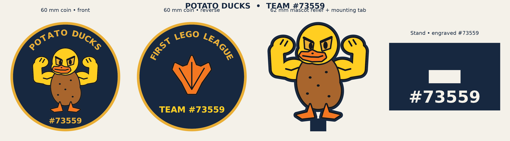

# Potato Ducks · FIRST LEGO League Team #73559

- [60 mm two-sided coin](Potato_Ducks_H2C_4color_CONFIGURED.3mf): the reverse reads FIRST LEGO LEAGUE around the webbed footprint. Print both halves artwork up. Also print [one set of alignment pins](coin_alignment_pins.3mf) per coin. Put the large and small pins into the matching sockets in one half, dry-fit the other half, then glue the plain backs together. The different pin sizes key the orientation. The pins print separately and sit inside the assembled coin. The finished coin is about 4.8 mm thick.
- [Standalone mascot and stand](Potato_Duck_Mascot_H2C_4color.3mf): print the flat-backed duck artwork up. The stand has #73559 engraved on top in front of the slot. The mounting tab is plain.

Open these as projects in Bambu Studio. Both use the H2C profile and four PLA colors: navy, brown, yellow and orange. Match those colors to your actual AMS spools before printing. The generic six-color 3MFs and color-separated STLs are included for other slicers. The generic four-color coin is geometry only; use the configured project above for the H2C.

Geometry and slicing checks are included. No physical print, pin fit, or stand fit test was performed. Dry-fit the pins before adding glue; if snug, lightly sand the pins.

To regenerate generic meshes and artwork, install the dependencies in `sources/requirements.txt` and run `python sources/build_models.py`. The native H2C projects retain their printer and filament settings separately.
