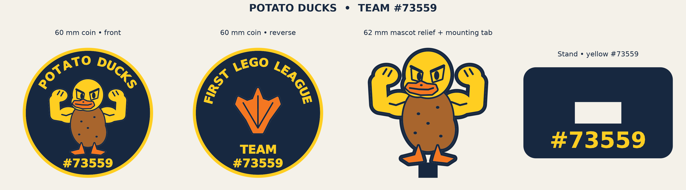

# Potato Ducks · FIRST LEGO League Team #73559



A 60 mm team coin that doubles as two fridge magnets and a freestanding display mascot, designed for multicolor 3D printing. The coin has a flexing Potato Duck on the front and a webbed footprint beneath **FIRST LEGO LEAGUE** on the back, with **TEAM** stacked above **#73559**. Both faces use the same bold lettering size. The display stand is engraved with **#73559** and filled with yellow.

## Which file should I open?

| To print | Open in Bambu Studio | What's included |
| --- | --- | --- |
| Coin or fridge magnets | [Coin project](print/coin/Potato_Ducks_H2C_4color_CONFIGURED.3mf) | Both halves with dual-use backs, plus two alignment pins |
| Replacement pins only | [Pin STL](models/stl/coin_alignment/coin_alignment_pins.stl) | Two identical pins; import as a model |
| Standalone mascot | [Mascot and stand project](print/mascot/Potato_Duck_Mascot_H2C_4color.3mf) | Flat-backed duck and separate engraved stand |

Open the coin and mascot files **as projects** to keep the Bambu Lab H2C settings and color assignments. They use four PLA colors: **navy, brown, yellow, and orange**. Match the project colors to your loaded AMS spools and check the sliced preview before printing. The two small navy pieces beside the coin halves are the alignment pins. If you need replacements, import the pin STL and use your normal PLA profile.

## Print and assemble the coin

1. Print both halves **artwork up**, with the socket openings against the build plate. Keep two identical pins for each coin.
2. Dry-fit the two Ø4.24 × 1.60 mm pins in the Ø4.44 mm sockets. Bring the plain backs together and check that the edges sit flush. The off-center socket pattern keys the orientation. Use both halves and pins from this revision together. If a pin is snug, lightly sand it and try again.
3. Apply a thin layer of PLA-compatible glue to the plain mating faces, join the halves, and hold them flat while the adhesive sets. The pins stay hidden inside the finished coin, which is **7.2 mm at the rim** and up to **8.0 mm over the raised artwork**.

## Make fridge magnets

Use the **same coin project**. Keep the halves separate and leave the pin sockets empty. Each face is **3.60 mm at the rim and 4.00 mm over the artwork** and has one centered **Ø6.30 × 2.05 mm** pocket. If you're assembling a two-sided coin instead, leave the center pockets empty and use the pins as above.

Print artwork up, then dry-fit one **Ø6 × 2 mm** disc magnet per face. Check that it attracts the intended fridge surface and seats flush or just below the back. Use a small amount of adhesive suitable for both PLA and the magnet coating, then let it cure before mounting. Holding strength depends on the magnet and fridge surface; test one face before printing a batch.

## Print and assemble the mascot

Print the duck flat with the artwork facing up and the stand with its slot facing up. Once the parts have cooled, slide the plain tab into the beveled slot opening. Face the duck toward the engraved **#73559** so the team number is visible. Dry-fit the tab before using any adhesive.

## Browse the files

| Folder | Contents |
| --- | --- |
| [`print/`](print/) | Configured H2C projects for the coin, pins, mascot and stand |
| [`models/3mf/`](models/3mf/) | Generic multipart 3MF exports for other printer setups |
| [`models/stl/`](models/stl/) | Color-separated STLs, pin geometry, and monochrome alternatives |
| [`sources/`](sources/) | Editable model generator and coin artwork |
| [`docs/`](docs/) | Design preview |
| [`validation/`](validation/) | Geometry and Bambu Studio slicing reports |

For the color-separated STLs, import all parts for a given model together as one multipart object so they stay aligned. Assign each part a filament using the color in its filename. Use the same yellow spool for yellow and yellow-accent parts, and the same navy spool for navy and navy-detail parts. There is no separate gold or black filament. The fused monochrome STLs preserve the body and sockets. Use the multipart models for the raised artwork and yellow stand number.

## Validation and rebuilding

The configured coin and mascot projects were sliced in Bambu Studio with a 0.4 mm nozzle and 0.20 mm layers. Both use a slower top-surface pass for a smoother finish. Coin lettering, duck, footprint and trim rise 0.40 mm above the navy field (two 0.20 mm layers). If navy still tints the lighter colors, check the navy-to-light flushing volumes in your AMS setup. The coin lettering was also checked against the sliced top-layer toolpaths. The geometry checks and slice results are in [`validation/`](validation/). No physical print or fit test was performed, so dry-fit the pins and stand before printing a batch.

To regenerate the generic models and artwork from the repo root:

```sh
python -m pip install -r sources/requirements.txt
python sources/build_models.py
```

The generator writes the generic exports, pin set, preview, and geometry report into the repository layout. The configured H2C coin and mascot projects are saved separately and are not rebuilt by this command.
